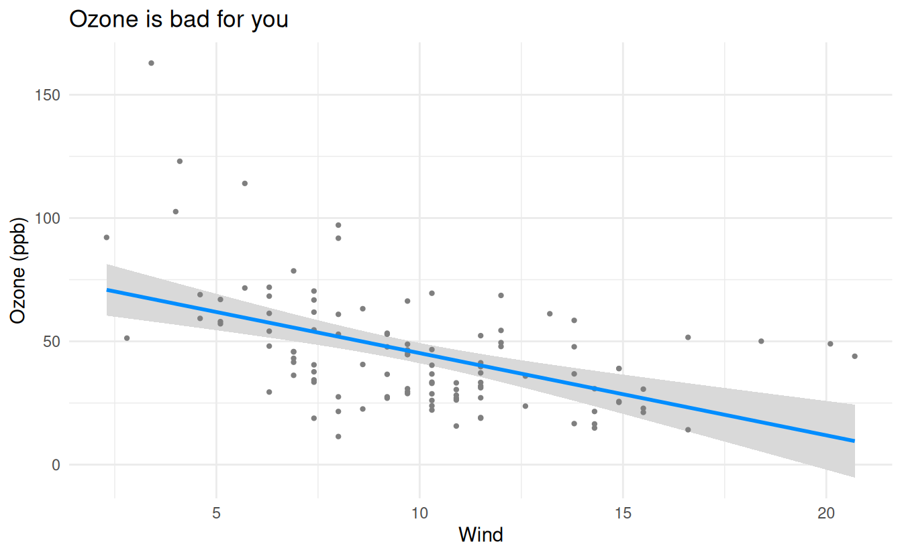
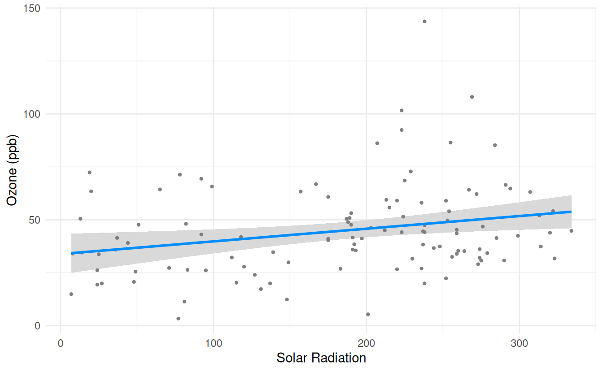
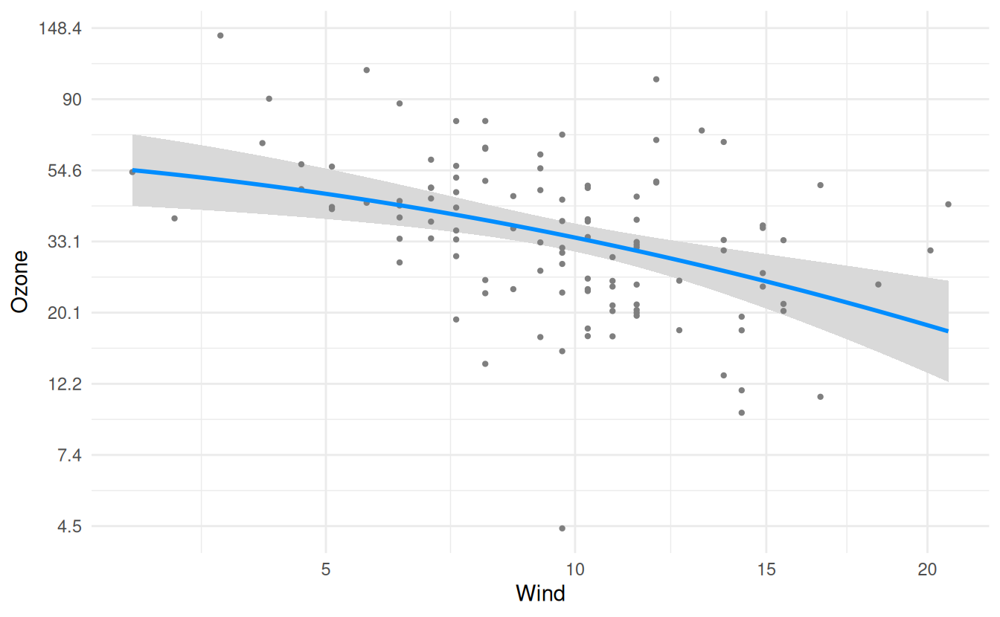
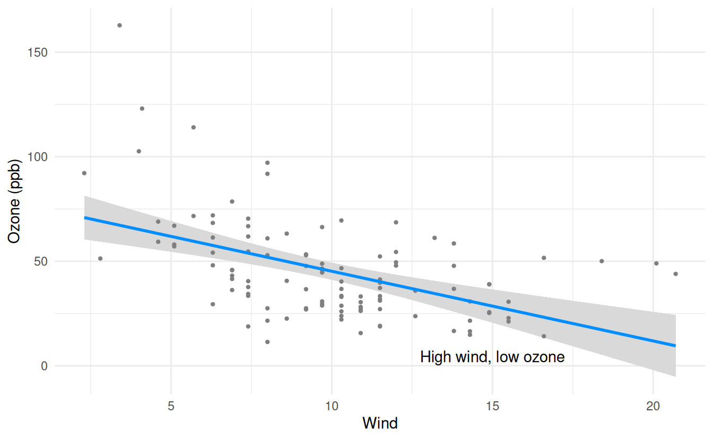
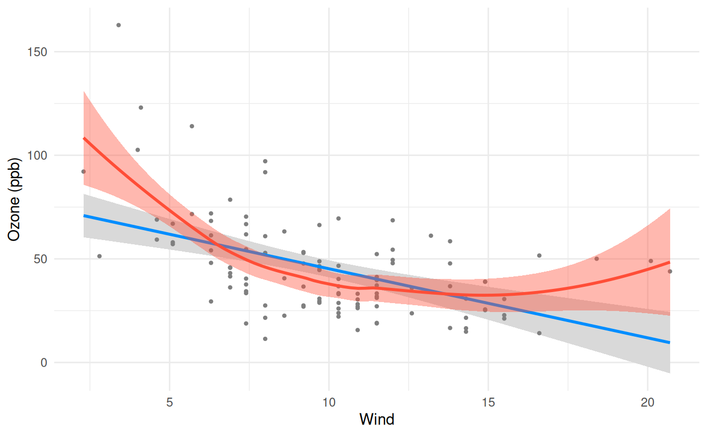
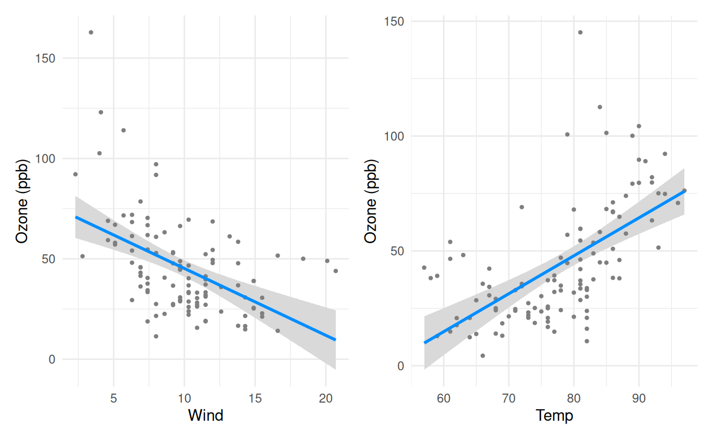

# Customizing with ggplot2

As of [version
3.0](https://pbreheny.github.io/visreg/articles/migrating-to-3-0.md)
[`visreg()`](https://pbreheny.github.io/visreg/reference/visreg.md)
always returns a `ggplot` object, so anything you already know about
customizing `ggplot2` plots works here too via `+`, exactly as it would
for any other `ggplot2` plot. The [Graphical
options](https://pbreheny.github.io/visreg/articles/options.md) article
covers the arguments
[`visreg()`](https://pbreheny.github.io/visreg/reference/visreg.md)
itself exposes for controlling the appearance of the line, band, and
points; this article covers everything else you can do to the plot once
it’s built.

First, let’s fit the following model:

``` r

fit <- lm(Ozone ~ Solar.R + Wind + Temp, data = airquality)
```

## Titles and axis labels

These are controlled through
[`labs()`](https://ggplot2.tidyverse.org/reference/labs.html):

``` r

visreg(fit, "Wind") + labs(title = "Ozone is bad for you", y = "Ozone (ppb)")
```



Note that if you are using the
[labelled](https://larmarange.github.io/labelled/) package to set a
label for a variable name, `visreg` will automatically use that label as
the axis title in place of the raw variable name, just like
[`ggplot()`](https://ggplot2.tidyverse.org/reference/ggplot.html) does:

``` r

library(labelled)
var_label(airquality$Solar.R) <- "Solar Radiation"
var_label(airquality$Ozone) <- "Ozone (ppb)"
visreg(fit, "Solar.R")
```



## Transforming axes

Axes can be transformed using any of `ggplot2`’s `scale_x_*()` and
`scale_y_*()` functions. For example, to fit the model on the log scale,
but plot it on the original scale (and also make the horizontal axis on
the square root scale for some reason):

``` r

logfit <- lm(log(Ozone) ~ Solar.R + Wind + Temp, data = airquality)
at <- seq(1.5, 5, 0.5)
visreg(logfit, "Wind") +
  scale_y_continuous(breaks = at, labels = round(exp(at), 1)) +
  scale_x_sqrt() +
  labs(y = "Ozone")
```



## Annotations

[`annotate()`](https://ggplot2.tidyverse.org/reference/annotate.html)
adds a single element to the plot without needing an accompanying data
frame:

``` r

visreg(fit, "Wind") +
  annotate("text", x = 15, y = 4.5, label = "High wind, low ozone")
```



## Adding a smooth

Layering a `loess` smooth on top of the fitted line is a useful
diagnostic: if it deviates noticeably from the (straight) fitted line,
that’s a sign the relationship may not be adequately captured by a
linear term for `Wind`.

``` r

visreg(fit, "Wind") +
  geom_smooth(method = "loess", col = "#FF4E37", fill = "#FF4E37")
```

    `geom_smooth()` using formula = 'y ~ x'



## Combining plots

The [patchwork](https://patchwork.data-imaginist.com/) package can
combine multiple plots into a single figure with `+`:

``` r

library(patchwork)
visreg(fit, "Wind") + visreg(fit, "Temp")
```


