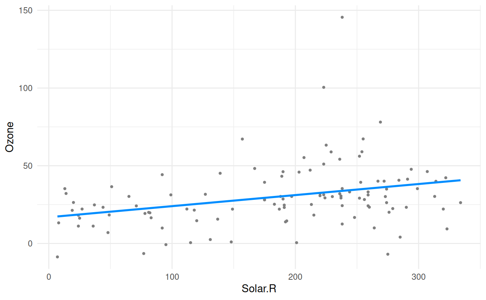
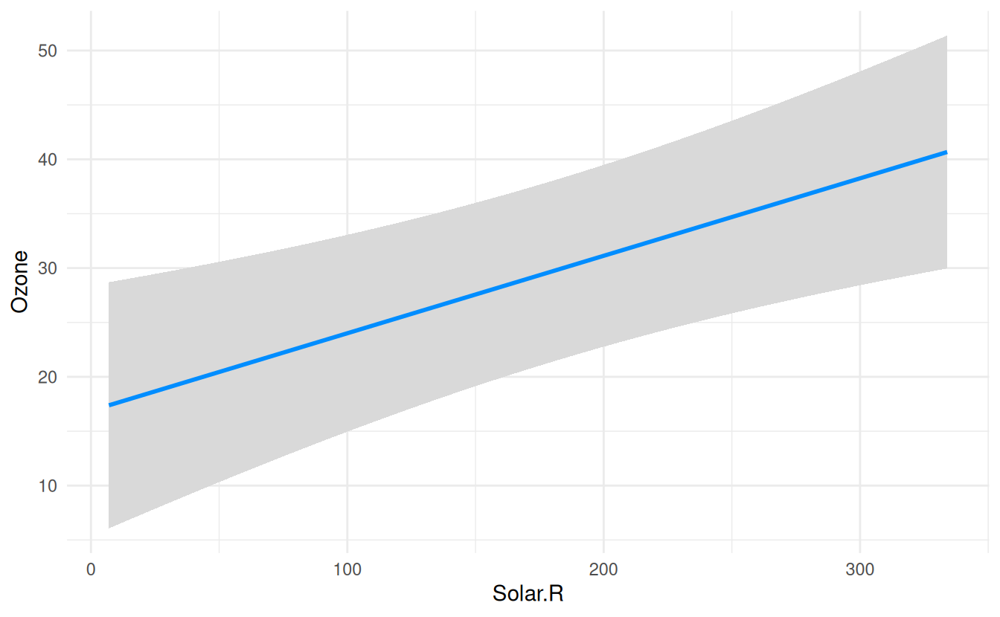
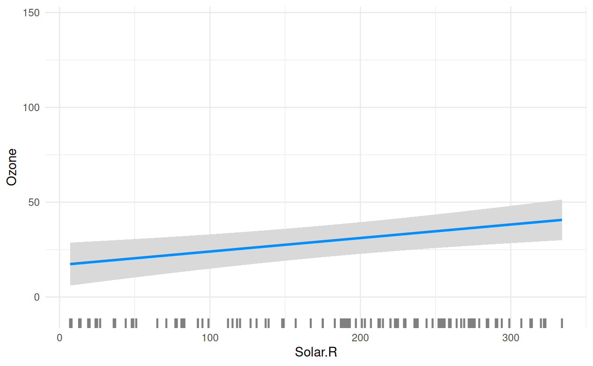
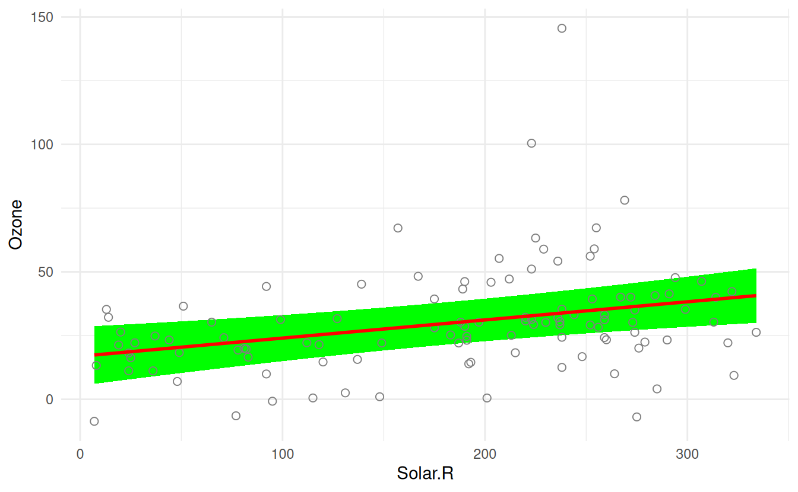
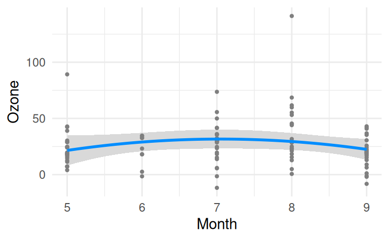
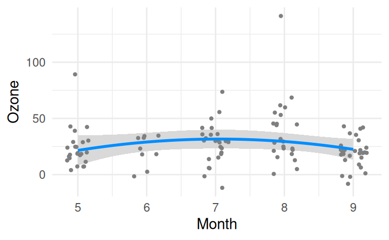
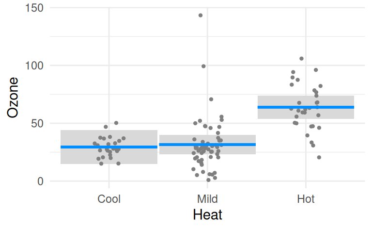
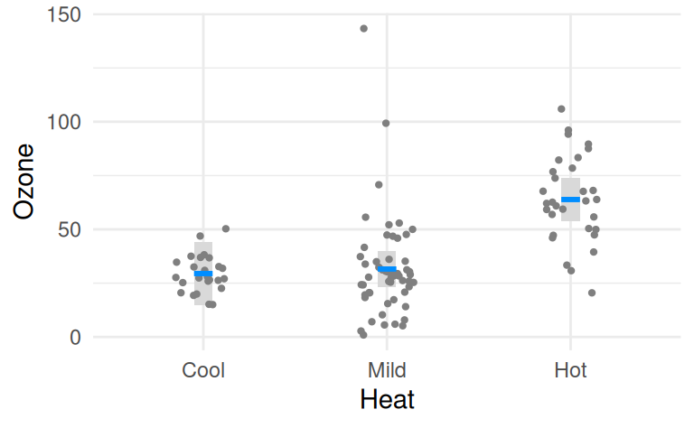

# Graphical options

`visreg` tries to set up pleasant-looking default options, but
everything can be tailored to user specifications. This article covers
options that must be controlled through
[`visreg()`](https://pbreheny.github.io/visreg/reference/visreg.md)
itself; other aspects of the plot, like titles, transforming axes,
adding annotations, etc., can all be handled using the [usual ggplot2
syntax](https://pbreheny.github.io/visreg/articles/gg.md). For the plots
below, we work from this general model:

``` r

airquality$WindLevel <- cut(
  airquality$Wind,
  3,
  labels = c("Calm", "Sorta windy", "Real windy")
)
airquality$Heat <- cut(airquality$Temp, 3, labels = c("Cool", "Mild", "Hot"))
fit <- lm(
  Ozone ~ Solar.R + WindLevel + Heat + poly(Month, 2),
  data = airquality
)
```

## Turning on/off plot components

By default, `visreg` includes the fitted line, confidence bands, and
partial residuals, but the residuals and the bands can be turned off:

``` r

visreg(fit, "Solar.R", band = FALSE)
```



``` r

visreg(fit, "Solar.R", partial = FALSE)
```



``` r

visreg(fit, "Solar.R", partial = FALSE, rug = TRUE)
```



## Appearance of points, lines, and bands

Specifying `col='red'` won’t work, because `visreg` can’t know whether
you’re trying to change the color of the line, the band, or the points.
These options must be specified through separate parameter lists:

- `line`: Controls the appearance of the fitted line
- `fill`: Controls the appearance of the confidence band
- `points`: Controls the appearance of the partial residuals

Each of these is passed along to the underlying `ggplot2` geom
(`geom_line`/`geom_ribbon`/`geom_point` for a continuous `x`, or
`geom_errorbar`/`geom_tile`/`geom_jitter` for a factor `x`), so any
parameter that geom accepts can be specified:

``` r

visreg(
  fit,
  "Solar.R",
  line = list(color = "red"),
  fill = list(fill = "green"),
  points = list(size = 2, shape = 1)
)
```



## Jittering

If there are many ties in a numeric variable `x`, jittering can be
helpful way to avoid overplotting. Compare the following two plots:

``` r

visreg(fit, "Month")
visreg(fit, "Month", jitter = TRUE)
```





## Band width for factors

When `x` is a factor, the width of the confidence band (and its
accompanying line) is controlled through the `fill`/`line` arguments’
`width` parameter:

``` r

visreg(fit, "Heat", line = list(width = 0.98), fill = list(width = 0.98))
visreg(fit, "Heat", line = list(width = 0.1), fill = list(width = 0.1))
```




